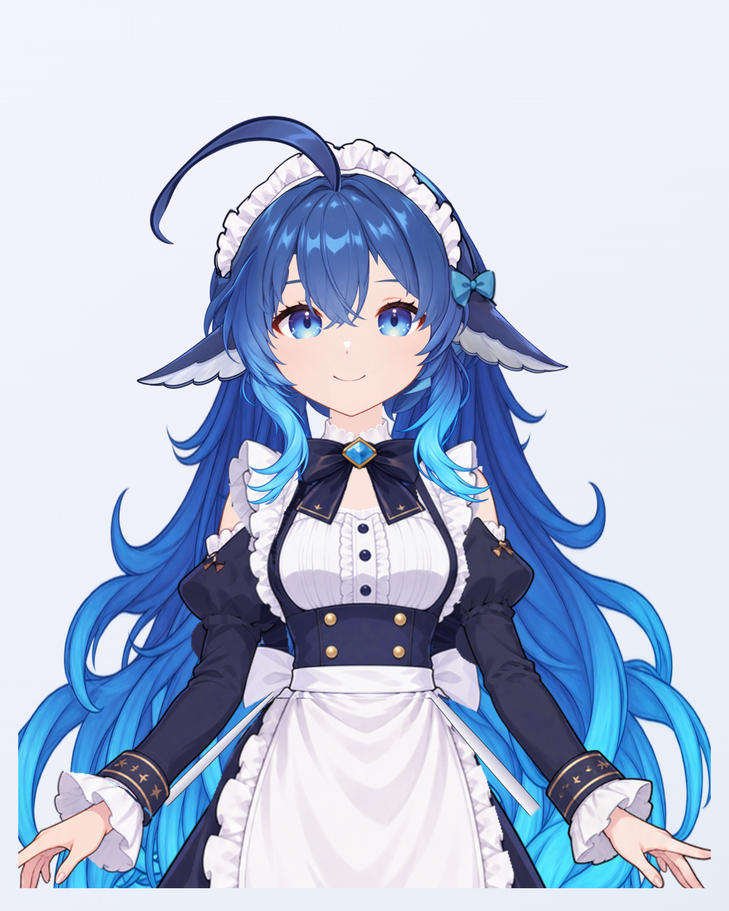
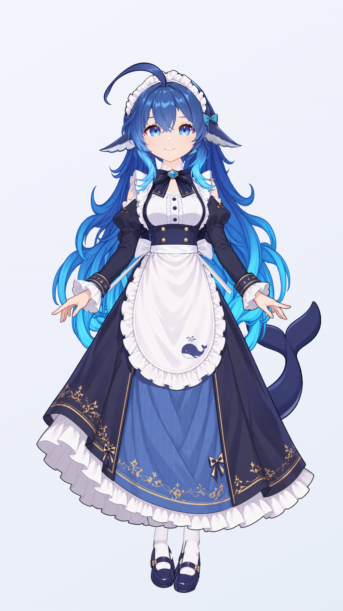
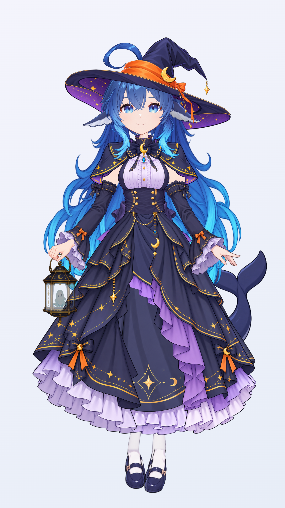

# Big Whale — a coding companion

[English](https://github.com/Aliciawque/dsh-big-whale/blob/main/README.md) · [简体中文](https://github.com/Aliciawque/dsh-big-whale/blob/main/README.zh.md) · [日本語](https://github.com/Aliciawque/dsh-big-whale/blob/main/README.ja.md)

[](https://www.npmjs.com/package/dsh-big-whale/v/0.6.0-rc.8)

A whale-girl desktop companion for DeepSeek Harness. She keeps you company while you code and reacts to session events. During compaction she holds a bowl of rice and dips her head. On completion she smiles and makes a peace sign in the maid outfit. On failure she draws her arms in, lowers her gaze, and shows a small sweat drop.

## Everyday maid outfit

<table>
<tr><th>Upper-body detail · 2048 × 2560</th><th>Full-body view · 2048 × 3640</th></tr>
<tr>
<td align="center"><a href="https://raw.githubusercontent.com/Aliciawque/dsh-big-whale/main/docs/screenshots/maid-halfbody-hd.png"></a></td>
<td align="center"><a href="https://raw.githubusercontent.com/Aliciawque/dsh-big-whale/main/docs/screenshots/maid-fullbody-hd.png"></a></td>
</tr>
</table>

Native renders from the released **0.6.0-rc.5** model. Click either image to open the full-resolution PNG.

Watch the [English feature demo on YouTube](https://www.youtube.com/watch?v=cyWnZlAHyJU) or the [Chinese demo on Bilibili](https://www.bilibili.com/video/BV17mxe6bEpe/).

## Halloween witch outfit

Open the floating whale menu and choose **Outfit → Little witch**. Switch back with **Everyday maid**. The menu button becomes a small pumpkin while the witch outfit is selected.

- **Layered costume:** witch hat, capelet, chest bow, sleeves, cuffs and layered skirt, with separate rebound physics.
- **Ghost lantern:** carried in her right hand, with delayed left/right swing and a repeating dim / half-bright / bright glow.
- **Matching rice pose:** witch sleeves and hands hold the giant rice bowl; use **Rice pose** to preview it.
- **Shared controls:** both outfits keep the same body size, expressions, idle motions, mouse following and speech controls. Menus open beside her, and the idle-amplitude slider remains available.

A user-initiated switch to the witch outfit plays the greeting in the selected language:

| 中文 | English | 日本語 |
| --- | --- | --- |
| 我是小魔女，不给糖就捣乱！ | I'm a little witch. Trick or treat! | 私は小さな魔女。お菓子をくれなきゃ、いたずらしちゃうよ！ |

<table>
<tr><th>Witch upper-body detail · 2048 × 2560</th><th>Witch full-body view · 2048 × 3640</th></tr>
<tr>
<td align="center"><a href="https://raw.githubusercontent.com/Aliciawque/dsh-big-whale/main/docs/screenshots/witch-halfbody-hd.png"></a></td>
<td align="center"><a href="https://raw.githubusercontent.com/Aliciawque/dsh-big-whale/main/docs/screenshots/witch-fullbody-hd.png"></a></td>
</tr>
</table>

Native renders from the released **0.6.0-rc.5** model. Click either image to open the full-resolution PNG.


## What she does

- Chinese, English and Japanese recorded voices with smooth lip sync.
- Mouse following, drag inertia, double-click upper-body view, eye and hair physics.
- Five idle motions and eight expressions; expressions can change while she speaks.
- Click interactions, gentle reminders to focus, event reactions and the rice pose.
- A small floating whale menu; Windows desktop mode or an in-page fallback.

## Install

Tested with **DSH 0.2.1-rc.5** and **Node.js 22.17+**. Use your existing Web-backed DSH profile; replace `web` with its name.

```sh
dsh plugin --profile web add dsh-big-whale@0.6.0-rc.8
dsh web
```

If DSH is already running, restart that profile. The public prerelease channel is `dsh-big-whale@next`.

Windows desktop mode uses the optional official Electron runtime. If your package manager skipped its install script, run this inside the installed plugin directory, then restart DSH:

```sh
node bin/desktop.mjs setup
```

The desktop pet stays visible when the DSH browser is minimized; the DSH host must remain running. Close her from the whale menu and reopen her from the whale launcher in DSH. Without an available desktop runtime, she appears inside the DSH page.

## Use with Claude Code

Big Whale also follows your Claude Code sessions: she thinks and works with you, waits with you at a permission prompt, cheers when a turn ends and holds the giant bowl of rice while the conversation is compacted.

At a Claude Code prompt:

```text
/plugin install big-whale --marketplace Aliciawque/dsh-big-whale
```

Answer `y` to add the marketplace, then choose a scope. From a shell: `claude plugin install big-whale --marketplace Aliciawque/dsh-big-whale`.

- Needs **Node.js 22.17+** on `PATH`. The plugin starts one local companion on `127.0.0.1`, shared by every session; it leaves about two minutes after the last session stops talking to it.
- On Windows she opens as the desktop window (if the Electron runtime is missing, run `node bin/desktop.mjs setup` in the installed plugin folder that `claude plugin list` shows). On macOS and Linux, run `/big-whale` for the companion page and open it in a browser.
- Only the main conversation is followed, not subagents. Tested with Claude Code 2.1.317 on Linux and Windows, including the Windows desktop window, permission prompts and compaction.

## Controls

Drag to place her; double-click to switch full body / upper body. Open the floating whale to choose language, play an introduction, change idle motion or expression, or show the rice pose.

Idle motions: natural breathing, body twist, side-to-side lean, shy sway and mixed showcase. Expressions: normal, happy, smiling eyes, unimpressed, surprised, tears, cute and playful anger, plus event-controlled selection.

Below the idle-motion selector, adjust sway amplitude from 20% to 120% (default 80%). Changes take effect immediately and are saved across restarts. Natural breathing keeps its gentle baseline.

The bundled voices need no Gemini or GLM key. DSH keeps its own model and provider settings. Arbitrary new text-to-speech is not included; phone timing within aligned words is estimated.

## Plugin markets

The repository includes a validated DSH format-1 index:

```text
https://raw.githubusercontent.com/Aliciawque/dsh-big-whale/main/market-index.json
```

In a DSH profile with Custom Plugin Market enabled, open **Plugins → Discover → Add index source** and add that URL. Community-directory discovery and official inclusion are separate processes. See [market details](https://github.com/Aliciawque/dsh-big-whale/blob/main/MARKETPLACE.md).

## Community acknowledgement

This project recognizes and supports [LINUX DO](https://linux.do/) and its open exchange of knowledge.

## License and credits

Plugin code has MIT notices. Character design and derivative visual assets are **CC BY-NC-SA 4.0**: attribution, noncommercial use and ShareAlike. Design credits: **上善无形** and **ZipZipPipe**. The code license does not grant commercial rights to the character.

This is a fan-made community project, not an official DeepSeek product. Artwork uses AI-assisted generation and refinement; voices are synthetic.

[Attribution](https://github.com/Aliciawque/dsh-big-whale/blob/main/ATTRIBUTION.md) · [License](https://github.com/Aliciawque/dsh-big-whale/blob/main/LICENSE) · [Privacy](https://github.com/Aliciawque/dsh-big-whale/blob/main/PRIVACY.md) · [Validation](https://github.com/Aliciawque/dsh-big-whale/blob/main/docs/VERIFICATION.md) · [Promotion drafts](https://github.com/Aliciawque/dsh-big-whale/blob/main/docs/PROMOTION.md) · [Issues](https://github.com/Aliciawque/dsh-big-whale/issues)
